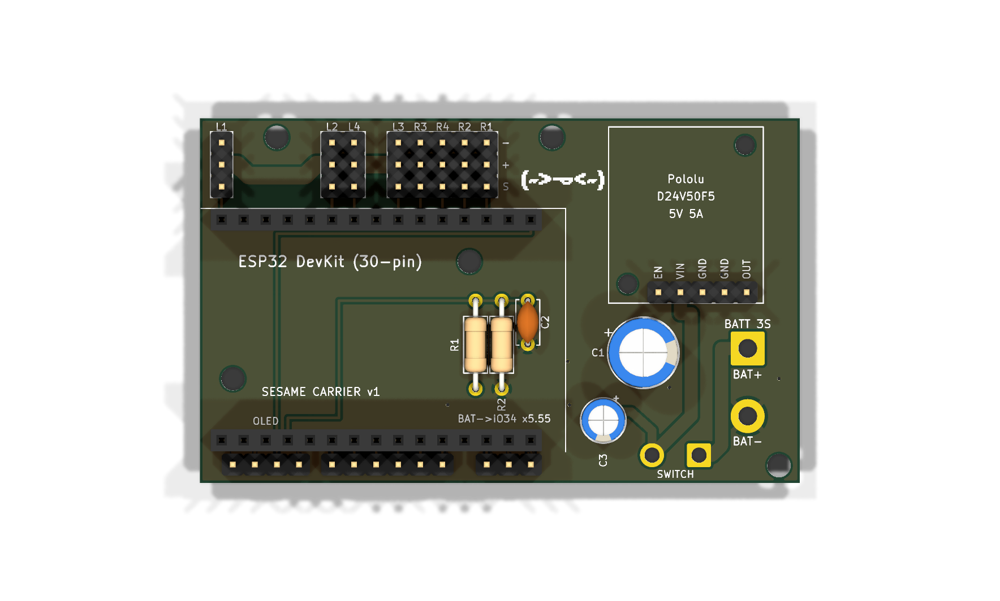
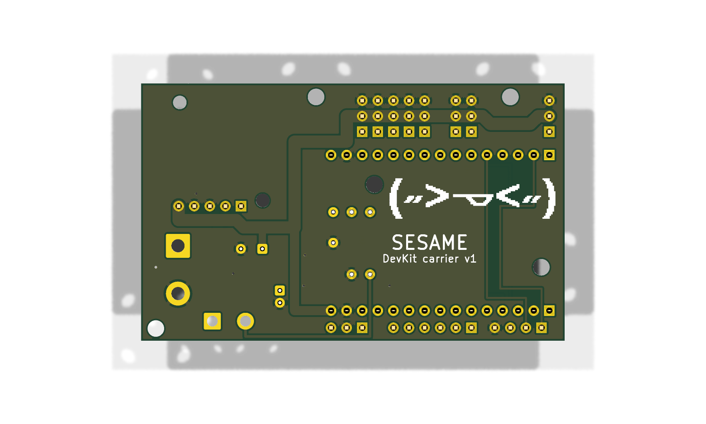

# Sesame DevKit Carrier v1

Plug-in carrier board for a **30-pin ESP32 DevKit (DOIT DevKit V1 style, 1.0" / 25.4 mm between pin rows)**.
Replaces hand wiring: 3S battery in (solder pads for a pigtail), onboard 5V/5A regulator, 8 servo headers, OLED header, battery voltage sense, spare I/O.

- Board: **69 × 42 mm**, 2 layers, 1.6 mm, all through-hole
- The DevKit's **antenna end hangs off the left edge** of the board, so the whole antenna is in open air (best Wi-Fi range). USB points inward, so **flash the DevKit before plugging it into the carrier** (it pops out of the sockets if you ever need to reflash)
- Pin map matches the firmware's "Distro Board V1 / DevKit" settings, so no firmware pin changes are needed
- Generated by `build_board.py` (run with KiCad 10's bundled python). Edit the script, not the `.kicad_pcb`, then re-run it.
- `audit.py` is an independent electrical check (netlist vs spec, firmware pin match, current capacity, ground fill, polarity, labels). Re-run it after any change; the last result is in `audit.txt`.
- `sesame-devkit-carrier.step` is the 3D model for designing the body around the board.




## Layout

```
          L1          L2 L4    L3 R3 R4 R2 R1
        ┌───────────────────────────────────────────────────────────────────┐
        │ - ▪          ▪ ▪     ▪ ▪ ▪ ▪ ▪   -        ◯     ┌──────────────┐  │
        │ + ▪──────────▪─▪─────▪─▪─▪─▪─▪   +  (servo 5V)  │ Pololu       │ ◯│
        │ S ▪          ▪ ▪     ▪ ▪ ▪ ▪ ▪   S              │ D24V50F5     │  │
 ┌──────┼─────────────────────────────────────────┐       │EN VIN G G OUT│  │
 │ ANT  │ ESP32 DevKit (two 1×15 sockets)   USB ->│       └──────────────┘  │
 │(over-│        battery divider underneath   ◯   │      (C1)     BATT 3S   │
 │hangs)│                                         │                BAT+ ■   │
 └──────┼─────────────────────────────────────────┘                BAT- ●   │
        │ C D V G   32 33 25 26 27 14   13 G 5V            SW ● ●        ◯  │
        │ OLED      spare I/O                                               │
        └───────────────────────────────────────────────────────────────────┘
```

The ESP32's antenna sits past the carrier's left edge with nothing under it, per Espressif's antenna-placement guidance. In the body design, keep metal (screws, battery, wires) away from that overhanging end of the DevKit.

## Ordering (PCBWay)

Upload `sesame-devkit-carrier-gerbers.zip`. Settings: 2 layers, 69 × 42 mm, 1.6 mm FR-4, 1 oz copper, HASL (lead-free) finish, any mask colour.

## Parts

| Ref | Part | Qty | Notes |
|---|---|---|---|
| J1, J2 | 1×15 female header, 2.54 mm, 8.5 mm tall | 2 | DevKit plugs in here |
| U1 | Pololu D24V50F5 (5V 5A step-down, #2851) | 1 | Solder straight into the board on its included 5-pin header. EN is left unconnected (pulled up on the module) |
| J6 | Battery pigtail pads (3.9 mm pads, 2.15 mm holes) | — | Solder a 16–18 AWG XT30 pigtail (female, to mate with the battery). Square pad = BAT+. Hot-glue or zip-tie the wires so they can't flex at the joint |
| SW1 | Wire pads for the power switch | — | 18 AWG to your rocker switch. No switch? Bridge the two pads with wire |
| S1–S8 | 1×3 male header, 2.54 mm | 8 | Servo plugs. Can be cut from 40-pin strips |
| J3 | 1×4 male header | 1 | OLED: C D V G = SCL, SDA, 3V3, GND |
| J4, J5 | 1×6 + 1×3 male header | 1 each | Spare I/O (optional) |
| C1 | 470 µF 16 V electrolytic, 8 mm dia, 3.5 mm pitch, ≤ 12 mm tall (e.g. Panasonic EEU-FR1C471) | 1 | 5V bulk cap. Mind polarity (+ marked) |
| C3 | 47 µF 35 V electrolytic, 5 mm dia, 2.0 mm pitch, ≤ 11 mm tall | 1 | Regulator input: damps the voltage spike when the battery/switch connects. Must be 35 V or higher. Mind polarity (+ marked) |
| R1 | 100 kΩ ¼ W (1% preferred) | 1 | Battery divider top |
| R2 | 22 kΩ ¼ W (1% preferred) | 1 | Battery divider bottom |
| C2 | 100 nF ceramic, 5 mm pitch | 1 | Sense filter |
| H1–H5 | M2.5 mounting holes | 5 | Corners, top-middle, and two under the DevKit (fit those before plugging the DevKit in). 3 mm copper keep-out: only ground fill under a screw head |
| HP1, HP2 | M2 holes under the Pololu's own mounting holes | 2 | One M2 screw through the module, a 3D-printed standoff (≈2.5 mm tall, ≤ 4 mm OD at HP1) and the carrier. 2.4 mm copper keep-out |

Solder R1, R2 and C2 **before** the DevKit sockets; they sit underneath the DevKit and must stay under ~7 mm tall.

## Pin map

| Function | DevKit pin | Board |
|---|---|---|
| Servo L1 / L2 / L3 / L4 | D23 / D19 / TX2 (17) / D18 | S headers, labelled |
| Servo R1 / R2 / R3 / R4 | D15 / D2 / RX2 (16) / D4 | S headers, labelled |
| OLED SDA / SCL | D21 / D22 | J3 |
| Battery sense | D34 (GPIO34, ADC1) | via 100k/22k divider, after the switch |
| Spare I/O | D32 D33 D25 D26 D27 D14 D13, GND, 5V | J4, J5 (each pin directly below its DevKit pin) |
| 5V in | VIN | from U1 |

Servo headers are **S + −** from the DevKit outward: orange toward the DevKit, brown on the outer (−) pin, nearest the top edge.

## Before you power it

1. **Check your DevKit's printed labels** against the silkscreen: antenna hanging off the left edge, USB pointing right, D23 at the antenna end of the row nearest the servo headers. Also check that the antenna (the zig-zag copper end of the module) starts at least ~2.5 mm past pin 1, so it clears the board edge.
2. **Pigtail polarity:** red to the square **BAT+** pad, black to **BAT−**. Plug the pigtail into the battery and check with a multimeter before soldering. The Pololu module has reverse-voltage protection, but check anyway.
3. With nothing plugged in, use continuity mode: 5V to GND, and battery + to GND, must **not** beep.
4. First power-up with the DevKit only, no servos. Measure 5V at the servo + pins before plugging servos in.

## Battery reading in firmware

`V_battery = V_GPIO34 × (100k + 22k) / 22k = V_GPIO34 × 5.545` (12.6 V full charge reads as 2.27 V, inside the ESP32 ADC's accurate 0.15–2.45 V range)

```cpp
float batteryVolts() {
  return analogReadMilliVolts(34) * 5.5455f / 1000.0f;   // 12.6 V full, ~10.5 V time to charge (3S)
}
```

## Verified against official documentation

| Item | Source | What was checked |
|---|---|---|
| ESP32 DevKit pinout | AITRIP listing photo (B08D5ZD528) | Pin order both rows, VIN/3V3 at USB end, 25.4 mm row spacing (measured), antenna starts ~5 mm past pin 1 (measured) |
| ESP32 pins | Espressif ESP32 datasheet v5.3 | GPIO34 = ADC1_CH6, input-only; strapping pins GPIO0/2/5/12/15 and their boot levels; ADC 12 dB range 150–2450 mV; 100 nF on the ADC input as in the datasheet test setup |
| Pololu D24V50F5 | pololu.com/product/2851 + dimension drawing 0J1436 | 6–38 V in, 5 V ±4 % out, reverse protection, EN pulled up; pin row 1.27 mm from edge, OUT 1.91 mm from right edge, 2.54 mm pitch, 1.02 mm holes |
| Hot-plug spikes | Pololu app note 0J16 | Spikes can exceed 3× the supply, worse with switch bounce; fix is an electrolytic across the input → C3 |
| C1 | Panasonic EEU-FR1C471 (distributor listings) | 8 mm dia, 3.5 mm lead spacing, 16 V |
| Fabrication limits | pcbway.com/capabilities | Tracks ≥ 0.30 mm (min 0.10), vias 0.4/0.8 mm, annular ring ≥ 0.35 mm (min 0.15), silkscreen text ≥ 0.8 mm and lines ≥ 0.15 mm |

KiCad DRC is clean (0 violations). Headers that deliberately sit side by side on the 2.54 mm grid are allowed in `sesame-devkit-carrier.kicad_dru`; `audit.py` checks their real spacing instead.

## Notes

- Antenna: overhangs the board edge entirely, to keep Wi-Fi range.
- The DevKit's own micro-USB is used for flashing (with the DevKit out of the carrier); there's deliberately no second USB-serial chip on the carrier.
- There's no schematic file; `build_board.py` is the source of truth for every connection.
- Board art: Sesame's own `cute` face `( 〃>ᴗ<〃 )`, read pixel-for-pixel from `firmware/face-bitmaps.h` at build time. Big on the back, half-resolution on the front (kept above the 0.15 mm silkscreen minimum).
